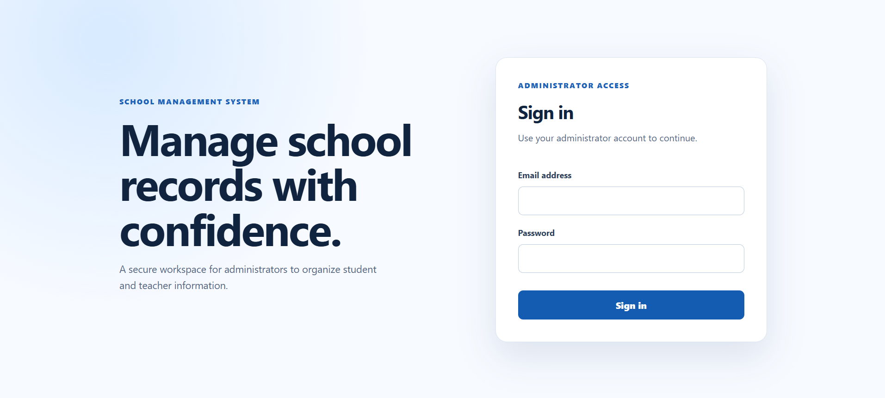
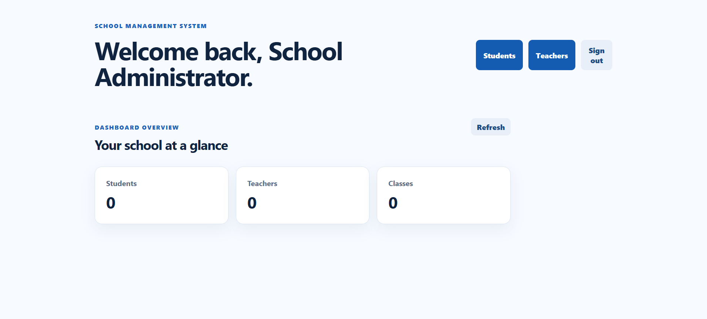
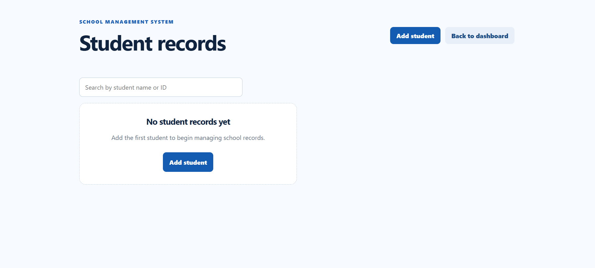
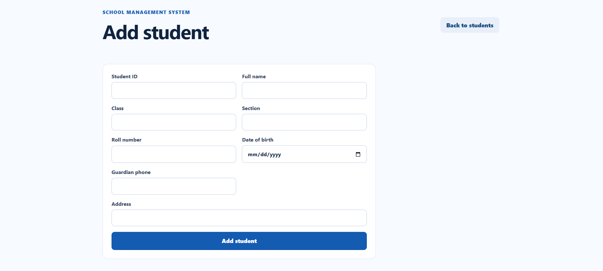
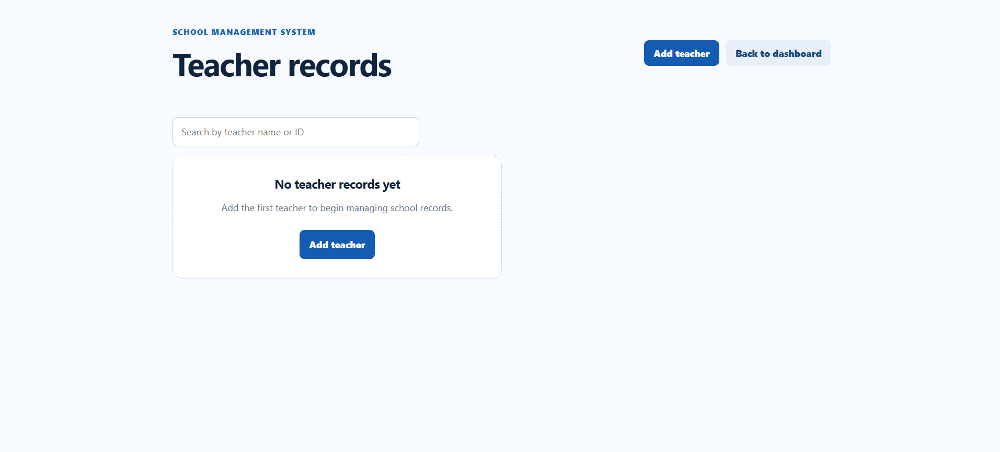
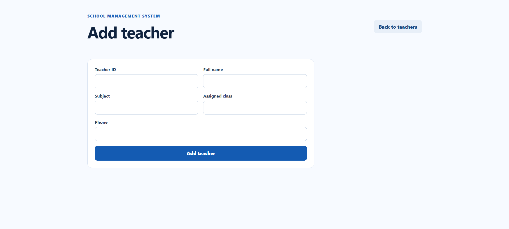
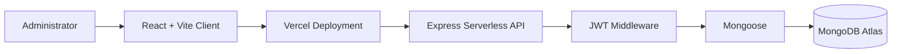
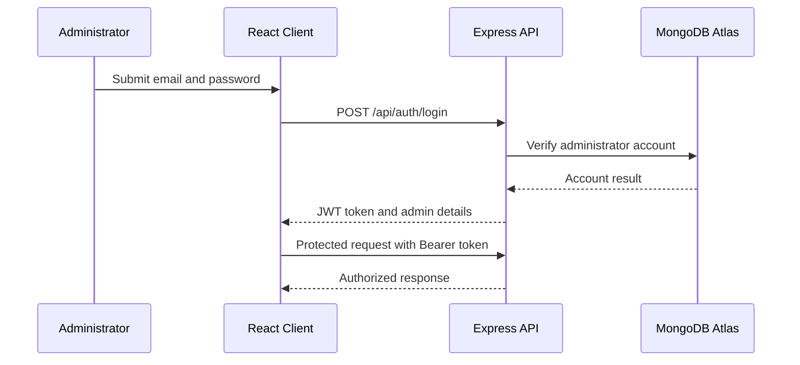

# School Management System

<p align="center">
  
  
  
  
  
  
  
</p>

<p align="center">
  <strong>A MERN Stack Student and Teacher Record Management Platform</strong><br />
  A secure, responsive workspace for school administrators to manage academic records efficiently.
</p>

<p align="center">
  <a href="https://school-management-system-client-livid.vercel.app">Live Demo</a> ·
  <a href="#features">Features</a> ·
  <a href="#run-locally">Local Setup</a> ·
  <a href="#api-overview">API</a>
</p>

<p align="center">
  
</p>

## Overview

School Management System is a full-stack web application built for school administrators. It provides authenticated access to a dashboard and makes student and teacher record management simple, organized, and secure.

**Live site:** [school-management-system-client-livid.vercel.app](https://school-management-system-client-livid.vercel.app)

## Application Screenshots

<p align="center">
  
  
</p>

<p align="center">
  
  
</p>

<p align="center">
  
</p>

| Screen | Description |
| --- | --- |
| Administrator login | Secure access to the management platform |
| Dashboard | Live student, teacher, and class summary |
| Student records | Search, add, edit, and delete student information |
| Teacher records | Search, add, edit, and delete teacher information |

## Features

- Secure administrator registration and login using JWT
- Protected administrator dashboard with live summary totals
- Student management: create, view, update, delete, filter, search, and paginate records
- Teacher management: create, view, update, delete, filter, search, and paginate records
- Class and section management with teacher and room details
- Daily attendance marking by date and class
- Subject-wise results with automatic percentage and grade calculation
- Dashboard enrollment chart and attendance insights
- Persistent dark-mode preference and administrator account settings
- Linked teacher, student, and guardian accounts with role-specific, read-only portals
- Cloudinary-ready student and teacher profile-photo upload (5 MB image limit)
- In-app activity notifications with individual and bulk read actions
- Admin audit history with action, record-type, and date filters
- Printable dashboard report via **Save PDF** in the browser print dialog
- Subject catalogue, class routines, academic notices, and bulk student promotion
- Printable student report cards with result and attendance summaries
- Teacher, student, and guardian accounts with role-based portals
- Bangladesh date/time, public login notices, password reset flow, rate limiting, and audit logs
- Clear empty states, confirmation before deleting, and manual dashboard refresh
- Persistent cloud database with MongoDB Atlas
- Production deployment on Vercel

## Technology Stack

| Layer | Technology |
| --- | --- |
| Frontend | React, Vite, CSS |
| Backend | Node.js, Express.js |
| Database | MongoDB Atlas with Mongoose |
| Authentication | JSON Web Token (JWT), bcrypt |
| Deployment | Vercel (React client) + Render (Express API) + MongoDB Atlas; Vercel serverless remains supported |

<p align="center">
  
</p>

## System Architecture



The React client calls REST API routes under `/api`. The recommended split deployment serves the client from Vercel and the Express API from Render; Mongoose connects the API to MongoDB Atlas. The existing same-origin Vercel serverless setup remains supported when `VITE_API_BASE_URL` is empty.

## Authentication Flow



The API verifies the JWT and reloads the account role from MongoDB for every protected request. Admin-only CRUD and operational endpoints return 403 to teacher, student, and guardian accounts. Staff/student/guardian accounts receive only their linked, read-only portal data. The browser hides admin screens by role as a usability measure; the server is the actual security boundary.

## Project Structure

```text
school-management-system/
├── client/        # React + Vite frontend
├── server/        # Express API, routes, models, middleware
├── api/           # Vercel serverless route handlers
└── assets/        # README preview and application screenshots
```

## Run Locally

### 1. Install dependencies

```powershell
pnpm install
```

### 2. Configure environment variables

Create `server/.env`:

```text
PORT=5000
MONGODB_URI=your_mongodb_atlas_connection_string
JWT_SECRET=your_long_random_secret
CLIENT_URL=http://localhost:5173
VITE_API_BASE_URL=
CLOUDINARY_CLOUD_NAME=your_cloud_name
CLOUDINARY_API_KEY=your_api_key
CLOUDINARY_API_SECRET=your_api_secret
SMTP_HOST=your_smtp_host
SMTP_PORT=587
SMTP_USER=your_smtp_user
SMTP_PASS=your_email_app_password
SMTP_FROM=your_sender_email
```

> Never commit `.env`, database credentials, or JWT secrets.

### 3. Start the backend

```powershell
cd server
node src/index.js
```

### 4. Start the frontend

Open another terminal:

```powershell
cd client
.\node_modules\.bin\vite.cmd
```

Open [http://localhost:5173](http://localhost:5173).

## API Overview

| Method | Endpoint | Description |
| --- | --- | --- |
| GET | `/api/health` | API health check |
| POST | `/api/auth/register` | Create the first administrator account |
| POST | `/api/auth/login` | Sign in and receive a JWT |
| GET/POST/DELETE | `/api/auth/users` | List, create, and remove linked teacher/student/guardian accounts |
| POST | `/api/auth/request-password-reset` | Email a six-digit password reset code |
| POST | `/api/auth/reset-password` | Reset password with the verification code |
| PUT | `/api/auth/change-password` | Change the signed-in administrator's password |
| PUT | `/api/auth/change-email` | Change the signed-in administrator's email |
| GET | `/api/dashboard/summary` | Get dashboard totals |
| GET/POST/PUT/DELETE | `/api/students` | Manage student records; list supports search, class/section filters, and pagination |
| GET/POST/PUT/DELETE | `/api/teachers` | Manage teacher records; list supports search, subject/class filters, and pagination |
| GET/POST/PUT/DELETE | `/api/classes` | Manage class and section records |
| GET, POST | `/api/attendance` | View and save daily attendance |
| GET/POST/PUT/DELETE | `/api/results` | Manage subject results and grades |
| POST | `/api/uploads/profile-image` | Upload a student or teacher photo to Cloudinary |
| GET/PUT | `/api/notifications` | View and mark activity notifications read |
| PUT | `/api/notifications/:id/read` | Mark one notification read |
| GET | `/api/audit-logs` | View paginated, filtered administrator activity history |
| GET | `/api/portal/overview` | Read role-specific teacher, student, or guardian workspace data |
| GET/POST/PUT/DELETE | `/api/subjects` | Manage subject catalogue |
| GET/POST/PUT/DELETE | `/api/routines` | Manage class routine entries |
| GET/POST/PUT/DELETE | `/api/notices` | Publish and manage notices |
| POST | `/api/promotions` | Promote selected students to a new class/section |
| GET | `/api/reports/report-card/:studentId` | Build a printable student report card |

All record-management routes require a valid administrator JWT token.

## Data Models

| Model | Main fields |
| --- | --- |
| User account | Name, email, bcrypt password hash, role (admin/teacher/student/guardian), linked teacher/student profile |
| Student | Student ID, name, class, section, roll, date of birth, guardian phone, address, photo URL |
| Teacher | Teacher ID, name, subject, assigned class, phone, photo URL |
| SchoolClass | Class name, section, class teacher, room number |
| Attendance | Student, date, present/absent status, note |
| Result | Student, subject, exam, marks, percentage, grade |
| Subject | Name, code, class, teacher, full marks |
| Routine | Class, section, day, subject, teacher, time, room |
| Notice | Title, message, audience, priority, expiry date |
| Audit log | Actor, action, entity, activity details |

Passwords are stored as bcrypt hashes; plain-text passwords are not saved in the database.

## Deployment

### Recommended split hosting: Vercel + Render + Atlas

`render.yaml` defines the Express web service and `/api/health` check. Create the Render service from this repository using the Blueprint, then set `MONGODB_URI` and `CLIENT_URL` in Render. `JWT_SECRET` is generated by the Blueprint. Set `CLIENT_URL` to the exact Vercel production URL (and add the preview origin as a comma-separated second origin only if preview access is needed). Never use `0.0.0.0/0` as a permanent database allowlist for production.

In Vercel, configure `VITE_API_BASE_URL` as the Render API origin, with no trailing slash (for example `https://your-api.onrender.com`), for Production and Preview, then redeploy the frontend. Set the same `MONGODB_URI` and `JWT_SECRET` in Vercel only if retaining the existing serverless API deployment. Do not expose database/JWT/Cloudinary secrets as `VITE_*` variables.

The current live Vercel deployment can continue using same-origin serverless routes when `VITE_API_BASE_URL` is empty. These are two supported deployment modes; only the mode whose environment variables and live smoke tests have been completed should be described as production-ready.

### Required API environment

```text
MONGODB_URI=your_mongodb_atlas_connection_string
JWT_SECRET=your_long_random_secret
CLIENT_URL=http://localhost:5173,https://your-vercel-domain.vercel.app
```

Restrict the Atlas IP access list to the smallest practical set for the chosen hosting environment; verify the provider's current outbound-IP guidance before changing production network rules.

## Cloudinary Image Storage

Cloudinary securely stores student and teacher profile photos. Add `CLOUDINARY_CLOUD_NAME`, `CLOUDINARY_API_KEY`, and `CLOUDINARY_API_SECRET` to local `server/.env` and Vercel environment variables. The flow is: image upload → Cloudinary URL returned → URL saved in MongoDB with the record.

## Risks and Challenges

| Area | Challenge | Current approach |
| --- | --- | --- |
| Security | Secret exposure | Environment variables are kept outside GitHub |
| Authentication | Unauthorized API access | JWT middleware protects record routes |
| Deployment | Serverless API route handling | Vercel API handlers route requests to Express |
| Database | Cloud connection availability | MongoDB Atlas with connection error handling |
| Data quality | Duplicate IDs or missing fields | Schema validation and API validation |

## Testing and Evaluation

Run automated server tests with `pnpm --filter server test`, build with `pnpm --filter client build`, and use the Postman collection in `postman/` for API smoke checks. The measurable acceptance targets, UAT checklist, and test procedure are documented in [docs/QUALITY-AND-UAT.md](docs/QUALITY-AND-UAT.md). A checklist is a test plan—not evidence of a successful production test; record actual results during faculty demonstration.

### Proposal alignment and limitations

- Student/teacher CRUD, search, attendance, results, role-aware portals, and operational UI are included in the current implementation.
- Fees/payments and automated SMS/email notifications remain out of scope. Email-based password reset requires SMTP configuration.
- Developed as a university **Web Programming Lab and Project** course project (**CSE 300**).
- Single-member project; user acceptance testing should be performed with faculty or a representative tester before final submission.

## Collaboration and Git Workflow

This is a solo university project. Development is organized through small, meaningful commits:

```text
Plan feature → Implement → Test locally → Commit → Push to GitHub main → Vercel deploys automatically
```

This keeps the commit history easy to understand and provides a clear record of project progress.

## Project Status

The proposal's core student/teacher record-management workflow is implemented, together with selected optional modules. Future work outside the current scope may include:

- Fine-grained teacher permissions for attendance and results entry
- Fee collection and accounting (excluded from the submitted proposal scope)
- SMS delivery for notices (requires an external messaging provider)
- Bulk import/export for large student and teacher datasets
- Automated database backup and restore workflows

---

Developed as a university Web Programming Lab and Project course project · CSE 300.
